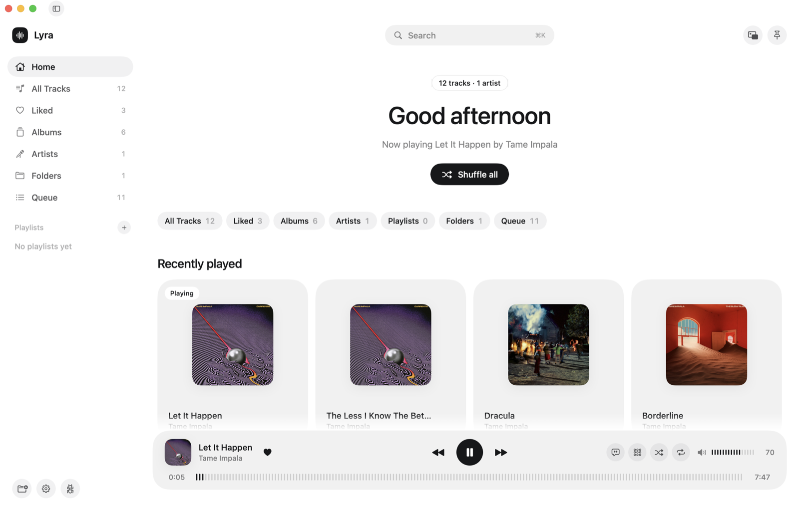
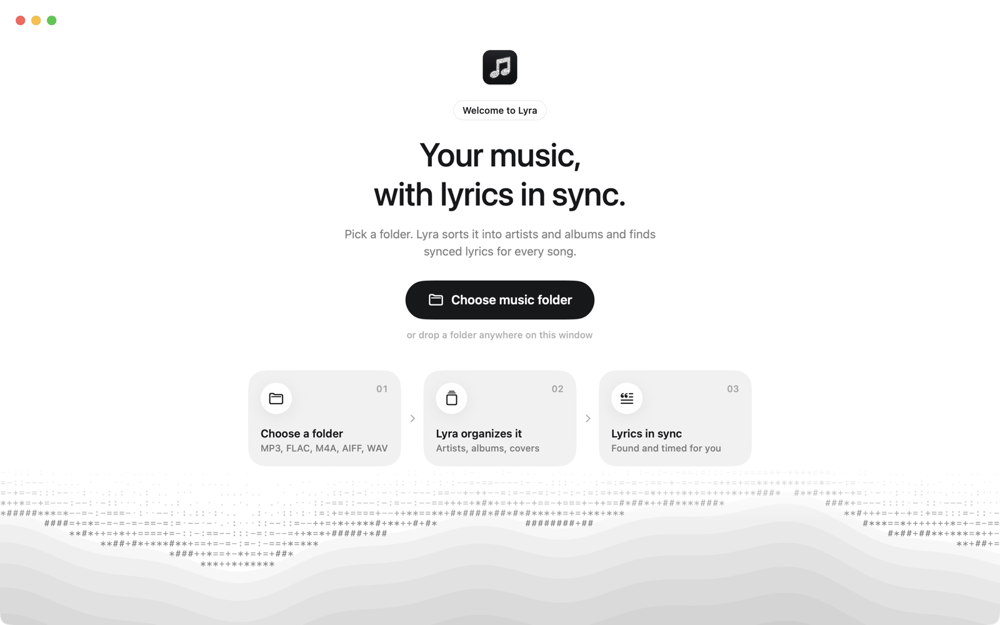
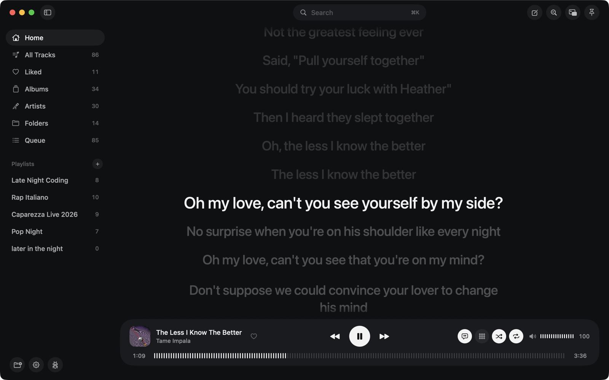
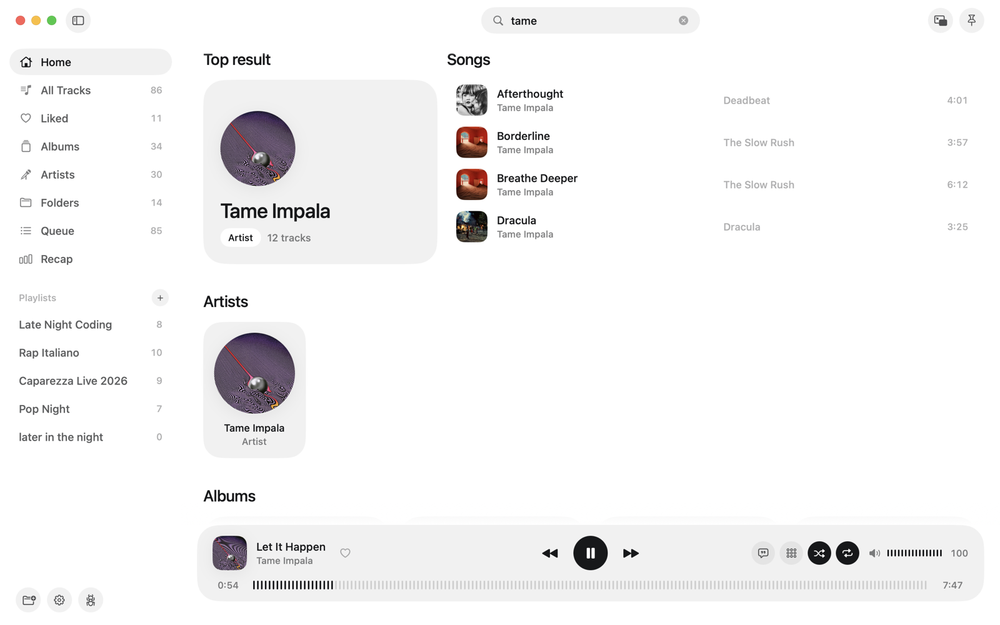
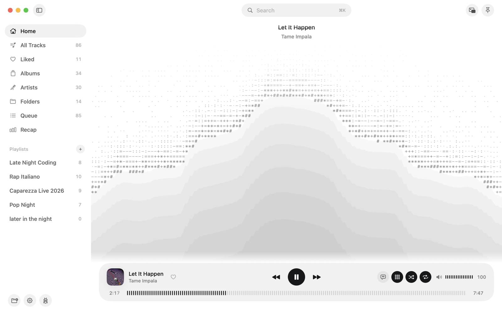
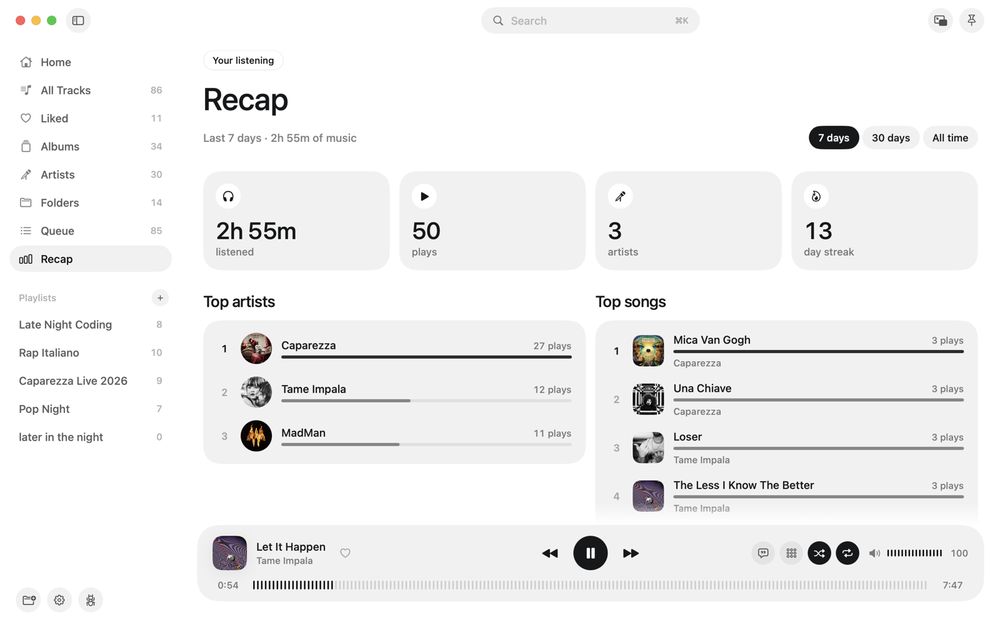
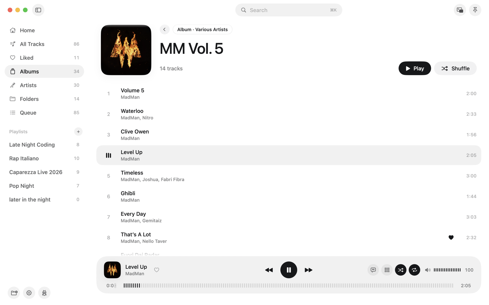
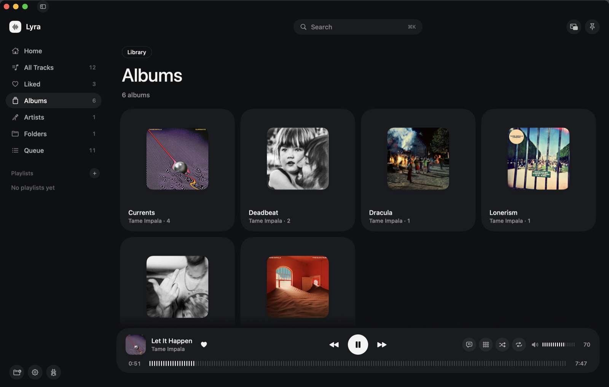
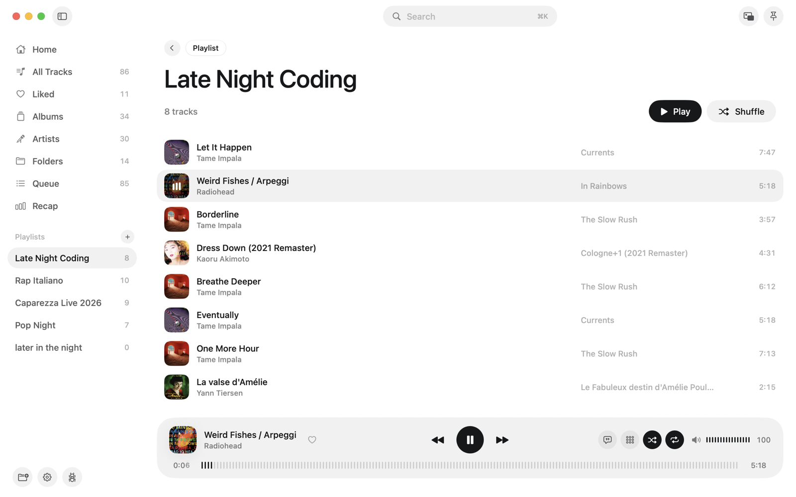
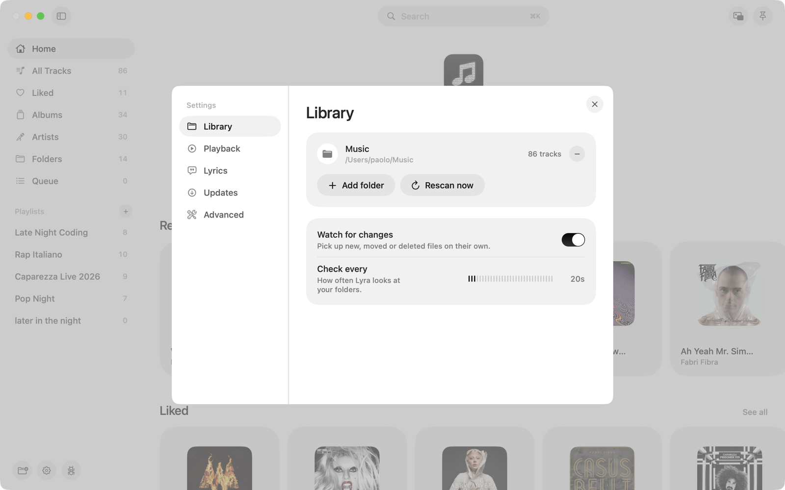

# Lyra

I still keep my music as files on my Mac. Most players for local libraries either look dated or don't show lyrics, so I built my own.

Lyra is a small macOS music player. You point it at the folder where your music lives, and it gives you a clean library to browse, plays your songs, and shows the lyrics in time with the music.



## Getting started



1. **Choose your music folder**, or drag it onto the window. MP3, FLAC, M4A, AIFF and WAV, subfolders included.
2. **Lyra organizes it.** It reads the tags and sorts everything into artists and albums, in track order, with covers. Your files aren't moved or renamed.
3. **Press play.** Lyrics are found and synced on their own.

## What it does

**Lyrics that follow the song.** Lyra finds synced lyrics online ([lrclib.net](https://lrclib.net)) and highlights each line as it's sung. Click a line to jump there. If a song isn't found, it tries cleaner versions of the title and artist (without "feat.", "remastered", and so on) and picks the best match. Lyrics are saved next to the song, so they also work offline.



**Search that understands what you mean.** Start typing and results show up right away, split into songs, artists, albums and playlists, with the best match on top. Press Return to open it.



**A visualizer you can actually look at.** A wave of stepped gray bands that rises with the music, bass in the middle and highs on the edges, and dissolves into ASCII characters at the crest.



**A recap of your listening.** Lyra remembers what you play (on your Mac, nowhere else) and turns it into a recap for the last 7 days, 30 days or all time: hours listened, top artists and songs, when in the day you listen, your streak, a few highlights in plain words, and badges to unlock.



**And the rest you'd expect.** Albums, artists, folders, liked songs, playlists, a queue, shuffle and repeat. A tiny always-on-top window for lyrics while you work. Media keys and Control Center. Light and dark mode.

| | |
|---|---|
|  |  |
|  |  |

## How it's made

Native SwiftUI and AVFoundation, no third-party dependencies.

- The visualizer taps the audio as it plays and runs an FFT on it with Apple's Accelerate framework.
- The library scan reads ID3, iTunes and FLAC tags (artwork, track numbers, multiple artists) and only re-reads files that changed.
- The look is my own small design system: a few color tokens for light and dark mode and a handful of shared components (pill buttons, tick sliders, tiles).

## Try it

You need macOS 15 or later and Xcode 16 or later.

```bash
swift run
```

Or open `Package.swift` in Xcode. To build a real `.app` and a `.dmg`:

```bash
./scripts/release_dmg.sh
```

To retake the screenshots in `docs/` (debug build, songs play muted, your own history and settings aren't touched):

```bash
./scripts/readme_screenshots.sh
```

Tests (lyrics parsing, matching and search ranking):

```bash
swift test
```
